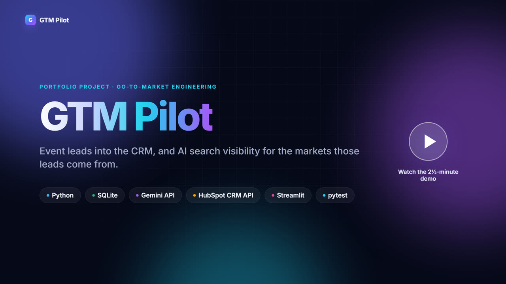

# GTM Pilot

Event-lead processing and AI search visibility tracking for go-to-market teams.

[](https://lihiniedirisingha.vercel.app/work/gtm-pilot.html)

**[Demo video and case study](https://lihiniedirisingha.vercel.app/work/gtm-pilot.html)** · part of my [portfolio](https://lihiniedirisingha.vercel.app/#gtm)

GTM Pilot answers two questions after an event:

1. **Which leads matter?** A raw badge-scan export is cleaned, each lead is classified by seniority, industry and decision-maker status, and the result is exported to HubSpot.
2. **Do AI assistants recommend us to those buyers?** Buyer-intent prompts for the industries the leads come from are sent to AI assistants, and each answer is analysed for brand mentions, ranking and recommendation stance.

The two pipelines share one core, so the visibility check targets the markets in the actual pipeline rather than generic prompts.

```
raw_leads.csv ─► clean ─► LLM enrich ─► SQLite ─► hubspot_import.csv / HubSpot API
                                          │
                              top industries by decision makers
                                          ▼
              prompts.yaml ─► Claude / OpenAI / Gemini ─► mentions, stance, citations ─► dashboard
```

## Quick start

No API keys are required. Without keys, all commands use a deterministic offline provider (mock mode).

```bash
git clone https://github.com/Lihini0202/gtm-pilot && cd gtm-pilot
python -m venv .venv && source .venv/bin/activate   # Windows: .venv\Scripts\activate
pip install -e ".[dev,dashboard]"

gtm-pilot demo-data                 # generate 220 sample rows with typical export defects
gtm-pilot run data/raw_leads.csv    # leads pipeline, then the visibility tracker
streamlit run dashboard/app.py      # dashboard at http://localhost:8501
```

Example output on the sample data:

```
220 rows in -> 196 clean leads | 19 duplicates removed, 16 email typos fixed, 5 rejected
Rejected rows saved to data/rejected_leads.csv for a human to check
196 leads saved (91 decision makers). HubSpot import file: data/hubspot_import.csv
40 leads are kept out of HubSpot without marketing consent (15 declined, 25 gave no answer)
Checking AI visibility for lead industries: Banking, Healthcare, Insurance
```

## Configuration

Copy `.env.example` to `.env`. The file is git-ignored; credentials are read from the environment only.

| Variable | Purpose |
|---|---|
| `GTM_BRAND` | Brand tracked in AI answers. Unset disables brand-specific reporting. |
| `GEMINI_API_KEY`, `ANTHROPIC_API_KEY`, `OPENAI_API_KEY` | LLM providers. Enrichment uses the first configured provider; the tracker queries all of them. |
| `HUBSPOT_TOKEN` | HubSpot service key or private app token, for HubSpot sync. |
| `GTM_MODE=mock` | Force mock mode regardless of configured keys. |
| `GTM_DB_PATH` | SQLite path (default `data/gtm_pilot.db`). |

Default models: `claude-sonnet-5-5`, `gpt-5-mini`, `gemini-flash-lite-latest`.

## Setup guides

### Gemini API key

1. Create a key in [Google AI Studio](https://aistudio.google.com/) and set `GEMINI_API_KEY` in `.env`.
2. Free-tier keys are rate limited per minute. Rate-limit responses are retried after the delay the API specifies, so a full run completes, at the cost of extra time.
3. Web search grounding (`--web-search`) needs Google Search grounding quota on the key. Some free-tier keys have none and return `429 RESOURCE_EXHAUSTED` for grounded requests. Check the limits in AI Studio. Billing may need to be enabled on the key's Google Cloud project.

### HubSpot

HubSpot API access uses one of two credential types, depending on the account:

| Account | Credential | Where |
|---|---|---|
| New accounts | **Service key** | Development → Keys → Service keys (some accounts: Settings → Integrations → Service keys) |
| Older accounts | **Legacy private app** | Development → Legacy apps → Create legacy app → Private |

If **Legacy apps aren't available on this account** is shown, use a service key. Both are sent as a bearer token, and GTM Pilot supports both without configuration.

**1. Create the credential.** Super admin access is required. Use a dedicated test account for the sample data.

- *Service key:* choose **Create a service key**, name it, add the scopes below and copy the key. It is shown once.
- *Legacy private app:* create the app, add the scopes below on the **Scopes** tab, then copy the token from **Auth → Show token**.

Required scopes:

| Scope | Used for |
|---|---|
| `crm.objects.contacts.read` | Reading existing contacts for change detection and dry runs |
| `crm.objects.contacts.write` | Creating and updating contacts |
| `crm.schemas.contacts.write` | Creating the custom properties (`--setup`); optional if they are created manually |

**2. Store the token** as `HUBSPOT_TOKEN` in `.env`. Do not commit it or share it in chat, tickets or logs. Rotate it if it is exposed; HubSpot recommends rotation every six months.

**3. Create the custom contact properties:**

```bash
gtm-pilot hubspot --setup
```

This creates any missing properties from the table below. To create them manually instead, go to Settings → Properties → Contact properties, using these internal names and types:

| Property | Type |
|---|---|
| `gtm_seniority` | Single-line text |
| `gtm_industry` | Single-line text |
| `gtm_decision_maker` | Single checkbox |
| `gtm_event` | Single-line text |
| `gtm_email_type` | Single-line text |

**4. Preview, then upload:**

```bash
gtm-pilot hubspot --dry-run   # read-only; writes data/hubspot_dry_run.csv
gtm-pilot hubspot             # upload stored leads
```

The dry run lists new contacts and every property that would change, and reports missing properties. An upload stops before writing anything if a required property is missing.

**Restoring deleted contacts.** Contacts deleted in HubSpot can be restored for 90 days from CRM → Contacts → Actions → Restore records. GTM Pilot never deletes contacts.

## Commands

| Command | Description |
|---|---|
| `gtm-pilot demo-data [--n N]` | Generate a sample lead export |
| `gtm-pilot leads <csv> [--upload] [--dry-run]` | Clean, enrich and export leads; optionally sync to HubSpot or preview the sync |
| `gtm-pilot hubspot [--dry-run]` | Sync stored leads to HubSpot, or preview the changes |
| `gtm-pilot hubspot --setup` | Create missing `gtm_*` contact properties |
| `gtm-pilot geo [--industry X] [--samples N] [--web-search]` | Run the visibility tracker; industries default to the top lead industries |
| `gtm-pilot schema page.html [--kind home\|article]` | Audit a page's schema.org structured data |
| `gtm-pilot run <csv>` | `leads`, then `geo` |

Output files are written to `data/`: `gtm_pilot.db`, `hubspot_import.csv`, `rejected_leads.csv`, `hubspot_dry_run.csv`, and `hubspot_failed.csv` if a batch fails.

## Visibility tracker configuration

Prompts, competitors and run settings are defined in [`gtm_pilot/geo/prompts.yaml`](gtm_pilot/geo/prompts.yaml):

| Key | Description |
|---|---|
| `templates` | Prompts per industry; `{industry}` is substituted |
| `general` | Prompts included in every run |
| `samples` | Samples per prompt (default 3); rates are computed over all samples |
| `web_search` | Ground answers in web search and record cited domains (Gemini) |
| `judge_stance` | Classify each brand as recommended, mentioned or negative |
| `brands` | Tracked brands and aliases; supports `case_sensitive` and `ignore` for names that are also common words |

Each tracker run is stored as a batch. Reports and the dashboard show one batch at a time, so results from different runs, providers or modes are never combined.

## Design decisions

- **Deterministic rules for deterministic work.** Email typos, duplicates, country names and consent values are handled in plain code (`leads/clean.py`). The LLM is used only for classification that requires judgement.
- **Validated model output.** Enrichment and stance results are checked against fixed value sets before storage. Invalid values are logged and replaced with defaults.
- **Bounded API usage.** Leads with the same title and company share one call, and results are cached per model. On the sample data, a first run makes 122 calls for 196 leads, and a repeat run makes none.
- **Resilient calls.** Rate limits and server errors are retried, using the server-specified delay where provided. Authentication errors fail immediately. A failed prompt, provider or HubSpot batch is logged and skipped without stopping the run.
- **Safe CRM sync.** Empty values are never sent, unchanged contacts are skipped, opted-out contacts are excluded, and every change can be reviewed with `--dry-run` first.
- **Measurable visibility.** Repeated sampling, stance classification and per-batch reporting make results comparable between runs. Brand matching uses word boundaries, optional case sensitivity and ignore phrases.
- **Credential handling.** Keys are read from the environment only and never appear in URLs, logs or `repr()`. Tests cover this.
- **Traceable rejections.** Rows that cannot be used are written to `rejected_leads.csv` with a reason, rather than dropped.

## Testing

```bash
pytest -q        # unit, mocked HTTP (LLM providers and HubSpot), end-to-end and headless dashboard tests
ruff check .
```

Tests make no network calls. LLM providers use the mock provider or a fake session, and HubSpot uses an in-memory fake API.

## Project layout

```
gtm_pilot/
  core/       configuration, HTTP retry policy, LLM client, SQLite schema, logging
  leads/      generate.py, clean.py, enrich.py, export.py
  geo/        prompts.yaml, track.py, schema_check.py
  cli.py
dashboard/    Streamlit app
tests/
.github/workflows/
  ci.yml          ruff and pytest on pull requests (Python 3.11, 3.13)
  weekly-geo.yml  scheduled weekly tracker run (set the GTM_BRAND repository variable)
```

## How I used Claude Code

### Scope

Claude Code was used for codebase review, implementation and live validation:

- Review of the existing codebase, followed by end-to-end validation in mock mode and against live services (Gemini, HubSpot).
- Retargeting of the visibility tracker to GTM Pilot's market segment: lead enrichment, data quality, event capture and AI-visibility tooling.
- Measurement methodology for visibility metrics: repeated sampling, stance classification, batch-scoped reporting, citation capture and stricter brand matching.

### Issues found during validation

| Issue | Detection | Resolution |
|---|---|---|
| Default Gemini model not available to new API keys (HTTP 404) | Model listing against the live API | Default changed to an available model |
| Retries ignored the provider's rate-limit delay; the first live run lost 68 classifications and 9 of 11 prompts | Run log analysis | Retries honour `Retry-After` and Gemini `retryDelay` |
| Over-restrictive aliases suppressed all Azure mentions (34 occurrences in stored answers) | Audit of stored answers against matched brands | Alias set revised; generic cloud terms remain excluded |
| Stance classification defaulted brands the model renamed or omitted | Review of run warnings | Tolerant key matching, one retry for omitted brands, unclassified values stored as NULL |

### Engineering decisions

- Version control operations require explicit owner approval.
- The tracked brand is configuration-driven (`GTM_BRAND`); no brand is hard-coded.
- HubSpot authentication uses a service key, as legacy private apps are unavailable on newer accounts.

### Next steps

- Scheduled weekly runs with trend reporting and a summary delivered to Slack or email.
- Web search grounding, so results reflect retrieved sources rather than model training data.
- A multi-run baseline before visibility metrics are used for decisions.

## Limitations

- Mock mode validates the pipeline only. Real visibility data needs API keys and repeated runs, because answers vary between calls.
- Without web search, answers come from the model's training data, which can differ from consumer assistants that search before answering.
- Web search is supported for Gemini only. Other providers answer without search, and those answers are recorded as ungrounded.
- HubSpot sync needs the five `gtm_*` contact properties (see [HubSpot setup](#hubspot)).
